<div align="center">

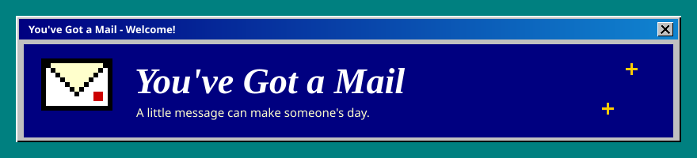

<p>
  <b>A messaging site that looks and feels like 1999, running on a 2026 stack.</b><br>
  Buddy lists, instant messages, group chats and four-person video calls with a CU-SeeMe filter, plus the 56k dial-up sound.
</p>

<p>
  <a href="https://uvgotmail.vercel.app"><b>Visit the live site »</b></a>
</p>

<p>
  
  
  
  
  
  
  
</p>

<sub>Best viewed at 800×600 in Netscape Navigator 4, or on any phone from 360px.</sub>

</div>

---

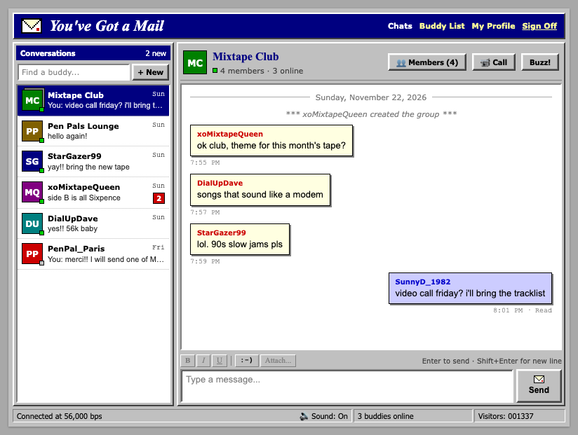

## What's inside

| | |
| --- | --- |
| 📨 **Send a surprise** | Leave a short note for someone from the homepage. It comes in three period skins: an AOL-style portal, a GeoCities homepage and Internet Explorer 5 on Windows 98. |
| 👤 **Screen names** | Sign on or sign up with a screen name, or sign on invisible. A synthesized 56k modem handshake plays as you connect, and you can mute it. |
| 💬 **Instant messages** | One-to-one chats and the public Pen Pals Lounge. Hearts (double-click a message), **Buzz!** (the window shakes), a typing indicator, read receipts and online dots. |
| 👥 **Group chats** | Private groups of 3–12 people. Anyone in the group can add members, rename it or leave. The last one out deletes it. |
| 📹 **Video calls** | Calls in DMs, groups and rooms for up to 4 people, browser to browser. A call rings everyone once, then anyone can drop in from the *Join* bar. |
| 📺 **CU-SeeMe mode** | Video is drawn at 160×120 and about 12 fps with scanlines. Switch on **Hi-Fi** to see the real picture. There are also mute, camera off, voice-only calls, a People list and Buzz! during a call. |
| 📱 **Phones too** | The same 1999 look, restacked for 360–430px screens: one column, 44px buttons and a toolbar at the bottom of calls. |

## A look around

<table>
  <tr>
    <td width="50%">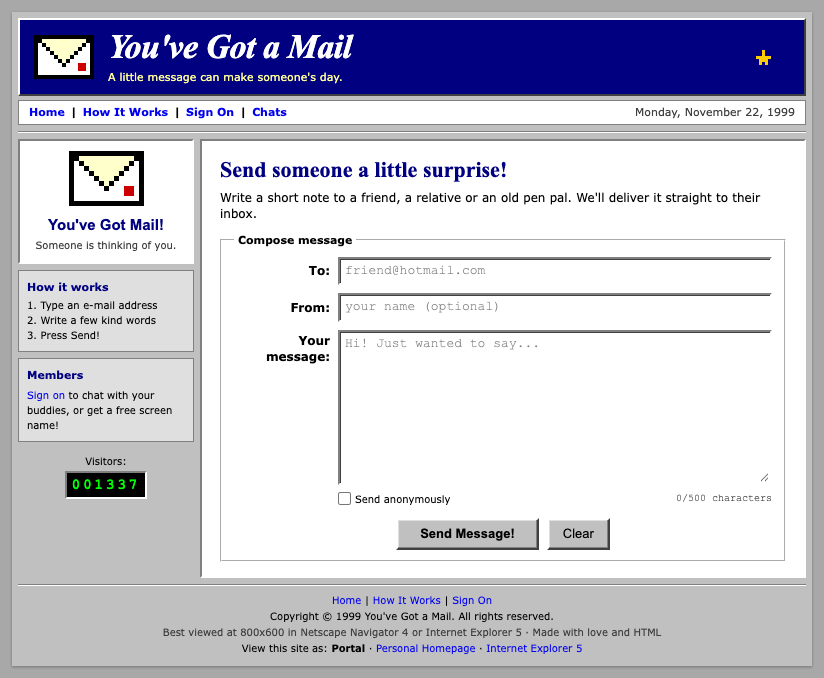<br><sub><b>The Portal:</b> send someone a little surprise</sub></td>
    <td width="50%">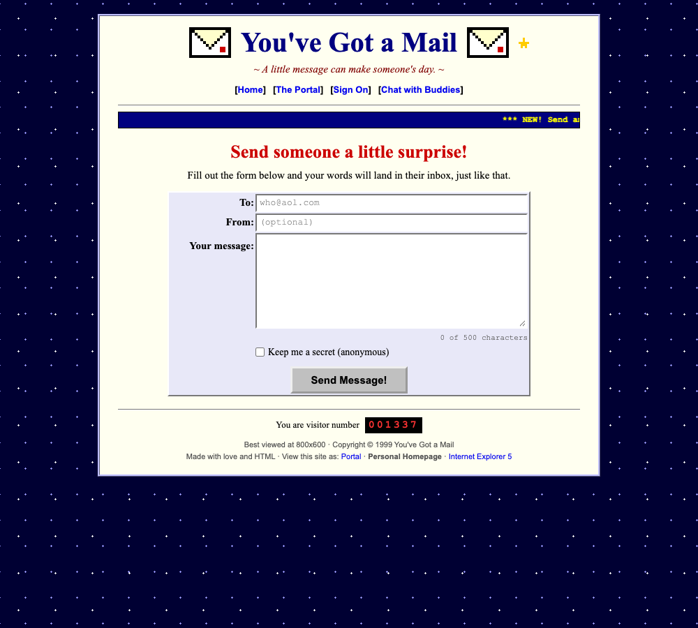<br><sub><b>The GeoCities skin:</b> starfield background and a marquee</sub></td>
  </tr>
  <tr>
    <td>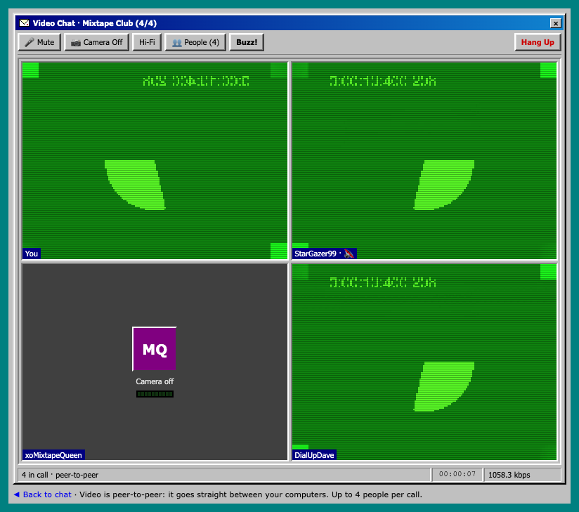<br><sub><b>Group call:</b> four people, CU-SeeMe filter, per-person mute and camera</sub></td>
    <td>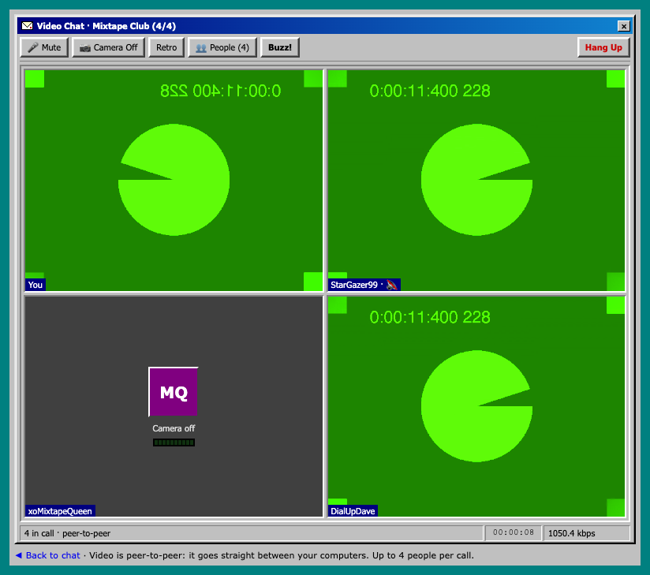<br><sub><b>Hi-Fi on:</b> the real picture, with no filter</sub></td>
  </tr>
  <tr>
    <td>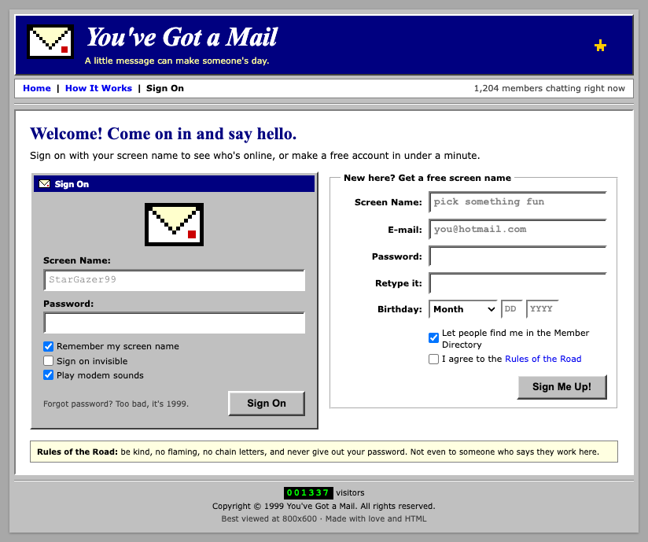<br><sub><b>Sign on:</b> screen name, password, invisible mode</sub></td>
    <td>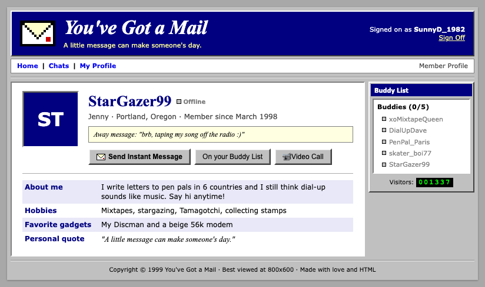<br><sub><b>Member profile:</b> Buddy List and the Instant Message window</sub></td>
  </tr>
</table>

<p align="center">
  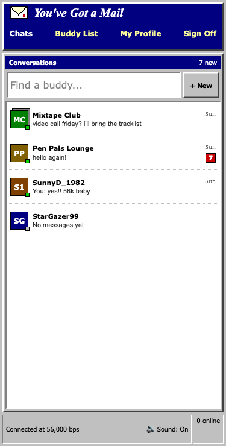
  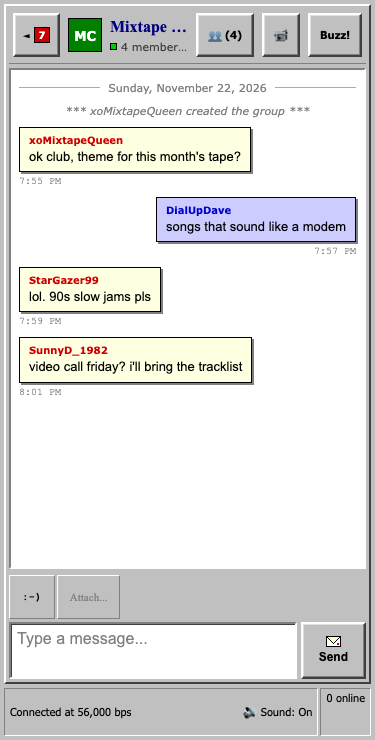
  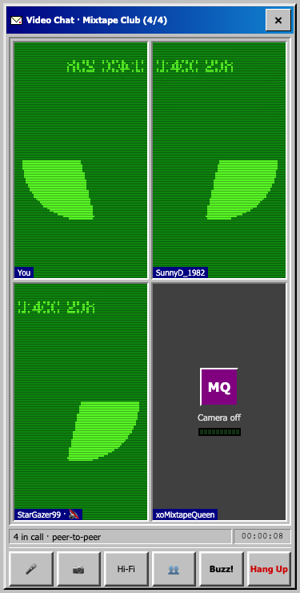
  <br><sub><b>On a phone:</b> conversations, a group thread and a four-person call</sub>
</p>

<sub>The call screenshots use Chrome's built-in test camera, which is where the green patterns come from.</sub>

## Try it

Open **https://uvgotmail.vercel.app**, then sign on with a demo member. Every demo member uses the password `password123`.

| Screen name | Good for |
| --- | --- |
| `SunnyD_1982` | The main demo account, with DMs and the Mixtape Club group |
| `StarGazer99` | Open in a private window and call Sunny |
| `xoMixtapeQueen`, `DialUpDave` | Fill up a four-person call in Mixtape Club |

To try a call, sign on as two members in two browser windows, open a shared conversation and press **📹 Call**. Allow the camera and microphone when the browser asks.

## Run it locally

You need Node.js 20 or later and a [Neon](https://neon.tech) Postgres database (the free plan is enough).

```bash
git clone git@github.com:AlvaroSena/uvgotmail.git
cd uvgotmail
npm install

cp .env.example .env.local   # fill in DATABASE_URL and BETTER_AUTH_SECRET
npm run db:migrate           # create the tables
npm run db:seed              # demo members, DMs, Pen Pals Lounge, Mixtape Club
npm run dev                  # http://localhost:3000
```

| Variable | What it is |
| --- | --- |
| `DATABASE_URL` | Neon connection string (the pooled one) |
| `BETTER_AUTH_SECRET` | Any long random string: `openssl rand -base64 32` |
| `BETTER_AUTH_URL` | Your site's address, `http://localhost:3000` in development |

> [!WARNING]
> `npm run db:seed` deletes and recreates the demo members, along with their conversations. Run it against a fresh database, not one that real people use.

### Scripts

| Command | What it does |
| --- | --- |
| `npm run dev` | Start the development server |
| `npm run build` / `npm start` | Make a production build and serve it |
| `npm run lint` / `npm run typecheck` | ESLint and TypeScript checks |
| `npm run db:generate` | Create a migration after changing `src/db/schema.ts` |
| `npm run db:migrate` | Apply the migrations in `drizzle/` |
| `npm run db:studio` | Browse the database in Drizzle Studio |

## How it works

### Pages

| Route | What's there |
| --- | --- |
| `/` | The Portal homepage and its "send a surprise" form. Notes are stored, not e-mailed. |
| `/home/geocities` · `/home/ie5` | The same form in the GeoCities and Internet Explorer 5 skins |
| `/signon` | Sign on or sign up |
| `/chat` · `/chat/[id]` | The conversation list and a thread: DMs, groups and the Pen Pals Lounge |
| `/members/[screenName]` | A profile with the Buddy List and the Instant Message window |
| `/call/[id]` | The video and voice call window |

Signed-out visitors are sent to `/signon` by `src/proxy.ts`.

### Chat

There are no WebSockets. Each open chat polls `POST /api/chat/[id]` every 2 seconds and gets back new messages, typing state and who's online. A member counts as online if they were active in the last 2 minutes and didn't sign on invisible. Changes like sending a message, a heart, Buzz! or group edits are server actions in `src/actions/`.

### Calls

```
 Browser A ◄──────── video & audio, peer-to-peer ────────► Browser B
     │                                                        │
     │  POST /api/calls/[id]/signal   (offer, answer, ICE)    │
     └──────────────►  Neon Postgres  ◄───────────────────────┘
                POST /api/calls/[id]?pid=  (poll + heartbeat)
```

- **A mesh of up to 4 people.** Every pair of people in a call has its own WebRTC connection, so the video goes straight between browsers and never through the server. When two people connect, the one who joined later sends the offer.
- **Signaling goes through the database.** Offers, answers and ICE candidates are stored as rows. Each person polls for the ones addressed to them every 1–2.5 seconds, and that poll is also their heartbeat. A window that goes quiet for 30 seconds is taken out of the call.
- **Route handlers, not server actions.** Next.js runs a page's server actions one at a time, so a burst of ICE candidates would keep *Hang Up* waiting. Signaling and hang-up are plain `fetch` calls to route handlers instead.
- **Ringing.** Starting a call rings everyone else in a DM or group for 45 seconds. The public room doesn't ring anyone. `IncomingCallWatcher` checks `POST /api/calls/incoming` every 3 seconds.
- **History.** When a call ends, it leaves a line in the chat such as `*** Group call · 12:03 · 3 people ***`.

> [!NOTE]
> Calls use Google's public STUN server and no TURN relay. Two people behind strict corporate or mobile networks may not be able to connect.

### Project layout

```
src/
├── app/                 routes, API route handlers, icons, global CSS (theme tokens + bevels)
├── actions/             server actions: auth, chat, buddies, groups, calls, notes
├── components/
│   ├── retro/           Win98 chrome: title bars, bevels, portal header
│   ├── pixel/           SVG pixel art (the envelope, stars, hearts)
│   ├── chat/            conversation list, thread, group dialogs, join bar
│   ├── call/            call window, WebRTC mesh hook, retro video filter
│   └── auth/ profile/ compose/
├── db/                  Drizzle schema, client and seed
├── lib/                 data access, sessions, presence, dial-up sound synth
└── proxy.ts             sends signed-out visitors to /signon
drizzle/                 SQL migrations
docs/                    README banner and screenshots
DESIGN.md                design brief and decisions log
```

## Built with

[Next.js 16](https://nextjs.org) (App Router, Cache Components) · [React 19](https://react.dev) · [TypeScript](https://www.typescriptlang.org) · [Tailwind CSS v4](https://tailwindcss.com) · [Drizzle ORM](https://orm.drizzle.team) · [Neon Postgres](https://neon.tech) · [Better Auth](https://better-auth.com) · [Zod](https://zod.dev) · WebRTC · Web Audio · deployed on [Vercel](https://vercel.com)

There are no image or sound files. Every icon is SVG pixel art drawn from text maps, and the dial-up handshake and ringtones are synthesized with Web Audio. The design brief and the reasons behind each decision are in [`DESIGN.md`](DESIGN.md).

<div align="center">
<br>
<sub>Made with love and HTML · Copyright © 1999 You've Got a Mail · Visitors: <code>001337</code></sub>
</div>
